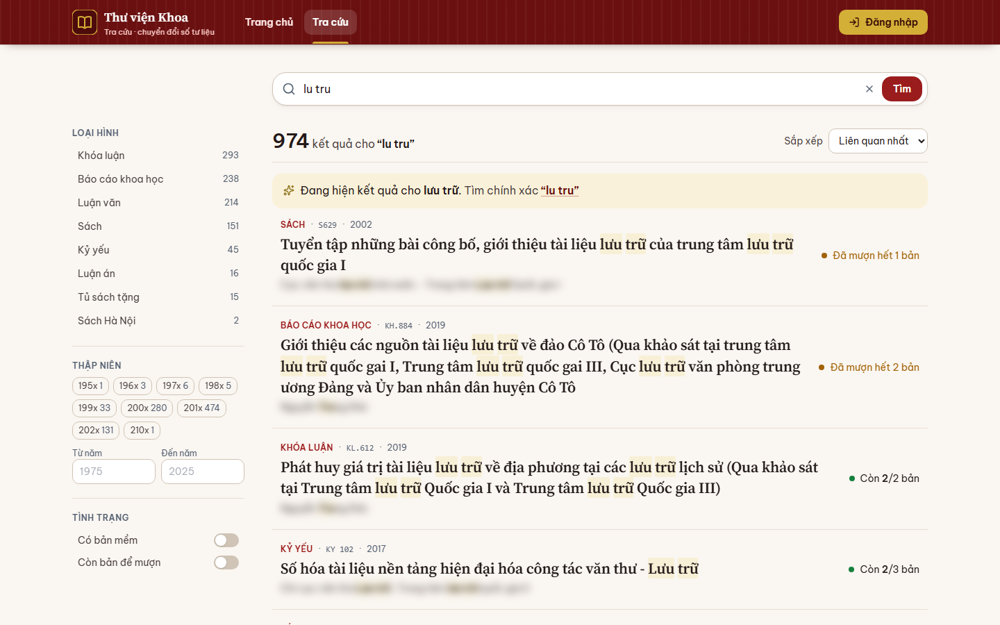
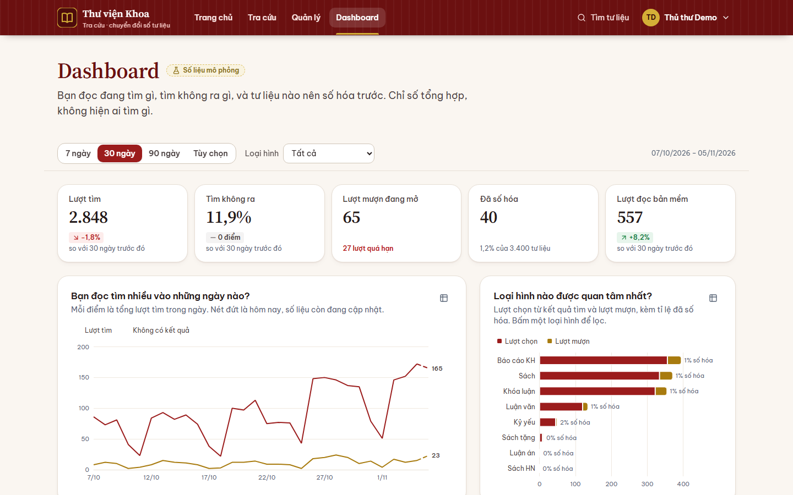
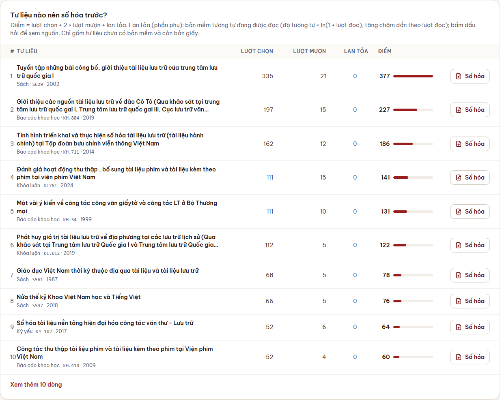
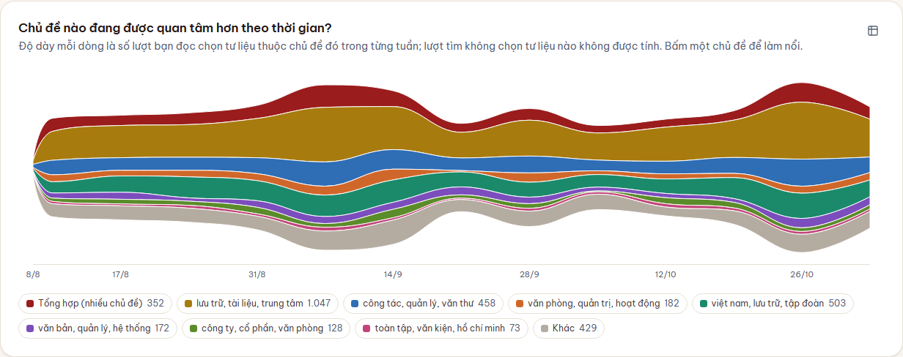
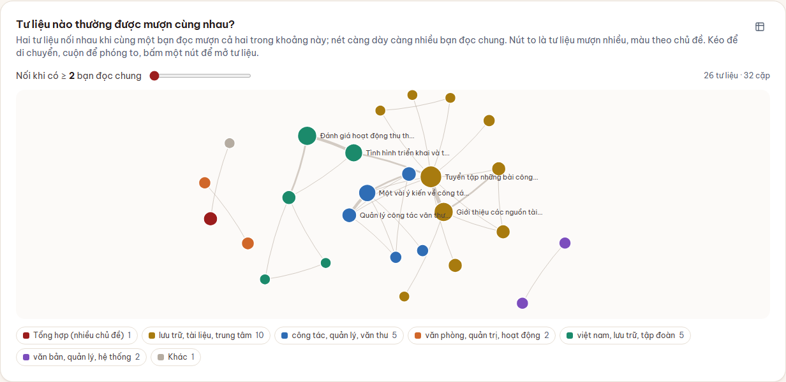
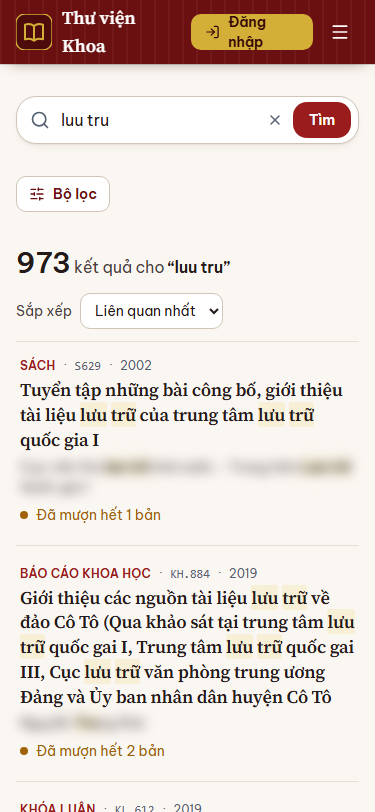

# Thư viện chuyển đổi số v2

Bản demo hỗ trợ quyết định **số hóa tư liệu nào trước**. Dữ liệu tìm kiếm, mượn và đọc bản mềm của bạn đọc được ghi lại, tổng hợp trên dashboard của thủ thư, rồi thủ thư số hóa (tải bản mềm PDF). Bản mềm được đọc lại sinh dữ liệu cho vòng sau:

```
bạn đọc tìm, mượn  →  ghi log  →  dashboard thủ thư  →  số hóa (tải PDF)  →  lượt đọc bản mềm  →  điểm "lan tỏa" cho vòng sau
```

Danh mục tư liệu là **dữ liệu thật** (3.400 tư liệu của Khoa, từ `data/[Bản chuẩn] DANH MỤC TƯ LIỆU KHOA.xlsx`). Log tìm kiếm, lượt mượn, lượt đọc và người dùng là **dữ liệu mô phỏng** (cờ `du_lieu_mau = true`, `seed = 42`), chỉ để trình diễn. Dashboard chỉ hiện số tổng hợp, không hiện ai tìm gì.

## Hình minh họa
Ảnh nằm trong `outputs/screenshots/` và `outputs/diagrams/` (sinh bằng `scripts/kiem_tra_toan_bo.*`, không commit). Họ tên tác giả và người hướng dẫn thật đã được làm mờ.

| | |
|---|---|
| Gõ sai "lu tru": hiện kết quả "lưu trữ", kèm "Tìm chính xác" |  |
| Dashboard của thủ thư |  |
| Nên số hóa, có điểm lan tỏa |  |
| ThemeRiver chủ đề theo thời gian |  |
| Đồ thị tư liệu mượn cùng nhau |  |
| Điện thoại (375px) |  |

Sơ đồ thiết kế (kiến trúc, ERD, use case, tuần tự tìm kiếm, mượn, số hóa, trạng thái lượt mượn): `outputs/diagrams/*.svg|png`, nguồn Mermaid ở `docs/diagrams/*.mmd`.

## Cấu trúc thư mục
```text
CK_v2/
├── backend/     FastAPI: app/ (api, core, models, schemas, services), alembic/ (migration), tests/ (pytest)
├── frontend/    React 18 + TypeScript + Vite + Tailwind: src/ (pages, components, api, hooks, lib)
├── pipeline/    ETL Excel, tách từ (pyvi), TF-IDF + KMeans, sinh dữ liệu mô phỏng; chạy độc lập: python -m pipeline.<lệnh>
├── e2e/         Playwright: tests/ (kịch bản đầu cuối, chụp ảnh), playwright.config.ts
├── scripts/     kiem_tra_toan_bo.ps1|.sh (kiểm tra một lệnh), chay_dev.ps1 (bật dev)
├── docs/        KE_HOACH.md, API.md (hợp đồng API), TIEN_DO.md, diagrams/*.mmd
├── data/        Excel danh mục gốc (chỉ đọc)
├── outputs/     Đầu ra sinh tự động: reports/, screenshots/, diagrams/, exports/ (không commit)
└── .env.example
```

## Yêu cầu
- PostgreSQL 18 (có gói contrib: `unaccent`, `pg_trgm`, `fuzzystrmatch`), Python 3.13, Node 24.
- Windows (các lệnh dưới dùng `backend\.venv\Scripts\python`; trên Linux/macOS đổi thành `backend/.venv/bin/python`).

## Cài đặt từ đầu
Chạy tại thư mục gốc `CK_v2` (PowerShell hoặc Git Bash).

1. **Tạo CSDL** (đổi `postgres` nếu dùng người dùng khác):
   ```bash
   psql -U postgres -c "CREATE DATABASE thu_vien_v2"
   ```
   Các extension được bật tự động khi chạy migration (cần quyền tạo extension).
2. **Cấu hình**: sao chép `.env.example` thành `.env`, sửa `DATABASE_URL` (mật khẩu PostgreSQL) và `JWT_SECRET`. Không commit `.env`.
3. **Python**: tạo venv và cài gói cho cả backend và pipeline:
   ```bash
   python -m venv backend/.venv
   backend/.venv/Scripts/python -m pip install -r backend/requirements.txt
   backend/.venv/Scripts/python -m pip install -r pipeline/requirements.txt
   ```
4. **Frontend**: `cd frontend && npm install`
5. **Dựng dữ liệu** (migration + ETL + tách từ + TF-IDF + dữ liệu mô phỏng, ~20 đến 30 giây):
   ```bash
   backend/.venv/Scripts/python -m pipeline.reset
   ```
   Kết quả mong đợi: 3.400 tư liệu, 5.817 bản sao, 63 người dùng, 400 lượt mượn, 8.000 log, 1.500 lượt đọc, 12 chủ đề.
6. **E2E (chỉ khi chạy Playwright)**: `cd e2e && npm install && npx playwright install chromium`

> Không dùng `TRUNCATE ... CASCADE` để dọn dữ liệu: lệnh này xóa cả các bảng có khóa ngoại. Luôn dựng lại bằng `pipeline.reset`.

## Chạy dev
```powershell
powershell -ExecutionPolicy Bypass -File scripts\chay_dev.ps1
```
hoặc thủ công, mỗi lệnh một cửa sổ:
```bash
cd backend  && .venv/Scripts/python -m uvicorn app.main:app --reload --port 8000
cd frontend && npm run dev          # http://localhost:5173, proxy /api sang 8000
```
Kiểm tra nhanh: `curl http://localhost:8000/api/health`. Giao diện thử không cần backend: `VITE_MOCK=1 npm run dev`.

## Tìm kiếm hoạt động thế nào
Hàm SQL `tim_tai_lieu` (migration `0004`), dùng chung cho API, gợi ý khi gõ và bộ sinh dữ liệu mô phỏng:
1. **Khớp cụm liền**: truy vấn được bỏ dấu, chữ thường (`unaccent`), rồi khớp liền các âm tiết trên chỉ mục full-text (`phraseto_tsquery`). "văn thư" chỉ ra tiêu đề có "văn thư" liền nhau, "học máy" không khớp "bộ máy ... xã hội học". Đảo thứ tự ("hồ sơ lưu trữ" ↔ "lưu trữ hồ sơ") không khớp (chủ đích, quyết định của người dùng).
2. **Sửa lỗi gõ**: nếu cụm gõ có ≤ 3 kết quả, tìm cụm gần nhất trong từ vựng tiêu đề (bảng `cum_tu`, Levenshtein chèn/xóa 1, thay 2, đổi chỗ hai ký tự liền nhau 1) và phổ biến hơn hẳn. Có cụm sửa thì kết quả là của cụm sửa (bản gõ nguyên văn xếp sau).

Giao diện làm như các công cụ tìm kiếm phổ biến: gõ `lu tru` hiện "Đang hiện kết quả cho **lưu trữ**. Tìm chính xác “lu tru”"; bấm vào thì gọi lại `/api/tim-kiem?...&chinh_xac=1` (chỉ khớp nguyên văn) và hỏi "Có phải bạn muốn tìm lưu trữ?". API trả `goi_y_sua` (cụm gần đúng) và `da_sua` (cụm đã dùng để tìm, `null` khi không sửa hoặc `chinh_xac=1`); chi tiết ở `docs/API.md`. Đánh giá: `backend/.venv/Scripts/python -m pipeline.danh_gia_tim_kiem` → `outputs/reports/danh_gia_tim_kiem_sau.md`.

## Tài khoản demo (dữ liệu mô phỏng)
| Vai trò | Tên đăng nhập | Mật khẩu |
|---|---|---|
| Thủ thư (gộp admin) | `thuthu` | `thuthu123` |
| Sinh viên | `sv01` | `sv123` |
| Giảng viên | `gv01` | `gv123` |

Khách không cần đăng nhập để tìm kiếm và đọc bản mềm công khai. Trang Quản lý và Dashboard chỉ dành cho thủ thư.

## Kiểm thử
| Lớp | Lệnh | Ghi chú |
|---|---|---|
| Backend | `cd backend && .venv/Scripts/python -m pytest -q` | Cần dữ liệu đã dựng (`pipeline.reset`); test tự dọn dữ liệu nó tạo |
| Frontend | `cd frontend && npm run test` | Vitest; `npm run build` kiểm tra kiểu |
| Đầu cuối | `cd e2e && npx playwright test --project=e2e` | Tự bật backend và frontend nếu chưa chạy. Có ghi dữ liệu (mượn, duyệt, số hóa): chạy `pipeline.reset` trước mỗi lần |
| Chụp ảnh | `cd e2e && npx playwright test --project=chup_anh` | Ra `outputs/screenshots/<vai_tro>/<trang>_{1440,375}.png` và `outputs/screenshots/dashboard/*.png`; làm mờ tên thật |
| **Tất cả** | `powershell -File scripts\kiem_tra_toan_bo.ps1` hoặc `bash scripts/kiem_tra_toan_bo.sh` | reset → pytest → vitest → build → chụp ảnh → E2E → xuất sơ đồ → reset sạch; in bảng đạt/lỗi, nhật ký ở `outputs/reports/kiem_tra/` |

Xuất lại sơ đồ riêng: `npx -y @mermaid-js/mermaid-cli@11 -i docs/diagrams/01_kien_truc.mmd -o outputs/diagrams/01_kien_truc.svg`.

## Kịch bản demo 7 phút
Chuẩn bị: `pipeline.reset`, bật backend và frontend, mở hai cửa sổ trình duyệt (một ẩn danh cho khách và sv01, một cho thủ thư). Dashboard mặc định 30 ngày; chuyển sang **90 ngày** khi cần thấy ThemeRiver và đồ thị dày hơn.

| Phút | Vai | Làm gì | Điều cần nói |
|---|---|---|---|
| 0:00 | Khách | Trang chủ: gõ `luu tr` → thấy gợi ý tư liệu và từ khóa → Enter | Gõ không dấu vẫn ra; kết quả có "Còn x/y bản", nhãn bản mềm. Mỗi lượt tìm được ghi log |
| 0:45 | Khách | Gõ `lu tru` → kết quả của "lưu trữ" với dòng "Đang hiện kết quả cho **lưu trữ**. Tìm chính xác “lu tru”" → bấm để xem đúng nguyên văn (2 kết quả). Gõ `hoc may` → 0 kết quả | Như các công cụ tìm kiếm phổ biến: sai chính tả nhẹ được tự sửa theo từ vựng tiêu đề, vẫn có lối tìm chính xác; "học máy" không khớp nhầm; lượt tìm 0 kết quả vẫn được ghi để thủ thư biết nhu cầu |
| 1:30 | Khách | Bấm một kết quả → trang chi tiết → "Đăng nhập để mượn". Thử vào `/dashboard` | Bị chặn, yêu cầu đăng nhập. Bấm vào kết quả cập nhật `tai_lieu_chon_id` cho log |
| 2:00 | sv01 | Đăng nhập `sv01 / sv123` → mở tư liệu còn bản → **Đăng ký mượn** → trang tài khoản, tab "Chờ duyệt" | Lượt mượn chờ thủ thư |
| 2:45 | Thủ thư | Đăng nhập `thuthu / thuthu123` → Quản lý → Chờ duyệt → **Duyệt** → thấy hạn trả (+14 ngày) | Gán bản sao trong transaction có khóa; hết bản thì báo 409 |
| 3:30 | Thủ thư | Dashboard: **5 thẻ KPI** (lượt tìm, tìm không ra, lượt mượn đang mở và quá hạn, đã số hóa, lượt đọc bản mềm; so với kỳ trước) | Chỉ số tổng hợp, không có ai tìm gì |
| 4:00 | Thủ thư | **Word cloud** và **top 15 từ khóa**: bấm một từ khóa → URL có `tu_khoa=`, toàn dashboard lọc theo từ đó (lọc chéo); **theo ngày** (7/30/90 ngày) | Đếm theo cả cụm truy vấn đã chuẩn hóa, gộp biến thể gõ sai. Bấm lại để bỏ lọc |
| 4:45 | Thủ thư | **ThemeRiver** chủ đề theo thời gian và **đồ thị mượn cùng nhau** (thanh ngưỡng từ 2 bạn đọc chung; bấm nút mở tư liệu). Trang Quản lý → Chủ đề để sửa nhãn (giữ khi dựng lại dữ liệu; có nút khôi phục nhãn tự động) | Chủ đề do máy gom từ tiêu đề (TF-IDF + KMeans); nhóm rời rạc tự gọi "Tổng hợp (nhiều chủ đề)"; nút cùng màu là cùng chủ đề |
| 5:30 | Thủ thư | Bảng **"0 kết quả"**: tìm thấy "học máy", "python", "trí tuệ nhân tạo" → gợi ý mua hoặc bổ sung | Tư liệu thư viện chưa có mà bạn đọc tìm nhiều |
| 5:50 | Thủ thư | Bảng **nên số hóa**: điểm = lượt chọn + 2 × lượt mượn + **điểm lan tỏa**; bấm dấu hỏi ở cột Lan tỏa xem nguồn | Lan tỏa = Σ độ tương tự × ln(1 + lượt đọc): tư liệu giống một bản mềm đang được đọc thì được cộng thêm một ít (lượt chọn, lượt mượn vẫn là chính). Đây là chỗ bản mềm "sinh dữ liệu cho vòng sau" |
| 6:15 | Thủ thư | Bấm **Số hóa** ở hàng đầu → kéo PDF vào (có sẵn `backend/storage/ban_mem/mau/ban_mem_mau.pdf`) → chọn Công khai → Tải lên → quay lại Dashboard | Tư liệu **rời bảng**, KPI "Đã số hóa" tăng 1 |
| 6:40 | Khách | Mở tư liệu vừa số hóa → **Đọc bản mềm** (tab mới) | Mỗi lượt mở ghi một dòng `luot_doc`: vòng lặp khép kín |
| 7:00 | | Kết: ảnh sơ đồ tuần tự số hóa (`outputs/diagrams/06_tuan_tu_so_hoa.svg`) | Dữ liệu là mô phỏng; danh mục là thật |

Sau demo: `backend/.venv/Scripts/python -m pipeline.reset` để về trạng thái sạch (xóa bản mềm đã tải lên).

## Hạn chế đã biết
- **Dữ liệu mô phỏng**: log tìm kiếm, lượt mượn, lượt đọc, người dùng. Số liệu dashboard không phản ánh nhu cầu thật. Seed cố định 42 để lặp lại được. Giao diện ghi rõ "Số liệu mô phỏng".
- **Chủ đề tự động chưa hoàn hảo**: KMeans trên TF-IDF tiêu đề nên có nhóm tạp; nhóm kém tập trung (silhouette trung bình < 0 hoặc < 50% tư liệu chứa một trong 3 từ nổi bật) tự nhận nhãn "Tổng hợp (nhiều chủ đề)". Thủ thư sửa nhãn ở Quản lý; nhãn tay lưu theo chữ ký cụm (5 từ nổi bật đầu) và được áp lại sau `pipeline.reset`/`pipeline.tuong_tu`. Nếu dữ liệu đổi nhiều đến mức cụm khác hẳn (Jaccard từ nổi bật < 0,5) thì nhãn tay không áp được (vẫn giữ trong bảng `chu_de_nhan_tay`).
- **Mã vấn đề** (QTVP, LTH, VB…) chưa có bảng giải nghĩa gốc; giao diện hiện mã, thủ thư nhập giải nghĩa ở Quản lý.
- **Trùng tiêu đề**: cùng một tác phẩm có thể nhập ở hai sheet (ví dụ cả "Kỷ yếu" và "Sách"), nên xuất hiện hai dòng cùng tiêu đề trong bảng nên số hóa. Điểm lan tỏa đã bỏ cặp trùng tiêu đề, nhưng hai dòng này vẫn tách rời.
- **Tìm kiếm** chỉ khớp **cụm liền** (sau khi bỏ dấu) và sửa lỗi gõ khi cụm gõ có ≤ 3 kết quả. Chủ đích: đảo thứ tự từ ghép không khớp ("hồ sơ lưu trữ" không ra "lưu trữ hồ sơ"), không có từ đồng nghĩa; gõ một phần từ ("luu tr") chỉ có ở gợi ý khi gõ. Khi đã tự sửa, kết quả là của cụm sửa, kèm lối "Tìm chính xác" (`chinh_xac=1`). Bộ ca đánh giá đạt 41/41 (`outputs/reports/danh_gia_tim_kiem_sau.md`); ngưỡng sửa lỗi chọn trên chính kho này nên có nguy cơ khớp quá với bộ ca.
- **Bản mềm** chỉ là PDF (≤ 20 MB, kiểm tra chữ ký `%PDF`); chưa OCR, chưa tìm trong nội dung. PDF mẫu chỉ là tệp tối thiểu.
- **Phạm vi demo**: chưa gửi email, chưa quên mật khẩu, chưa đổi mật khẩu, chưa có tài khoản mới; chưa cấu hình triển khai thật (HTTPS, CORS, secret).
- **Điểm lan tỏa** tăng theo ln(1 + lượt đọc) nên rất nhỏ so với lượt chọn/mượn (lớn nhất ≈ 5 điểm trên dữ liệu mô phỏng); nó chủ yếu xếp thứ tự trong nhóm tư liệu ít nhu cầu trực tiếp (`outputs/reports/lan_toa_truoc_sau.md`).
- Các script dùng đường dẫn Windows (`.venv\Scripts`); trên hệ điều hành khác cần đổi.

## Tài liệu liên quan
`docs/KE_HOACH.md` (kế hoạch và các chặng), `docs/API.md` (hợp đồng API), `docs/TIEN_DO.md` (tiến độ và kết quả kiểm chứng), `CLAUDE.md` (quy ước cho agent).
