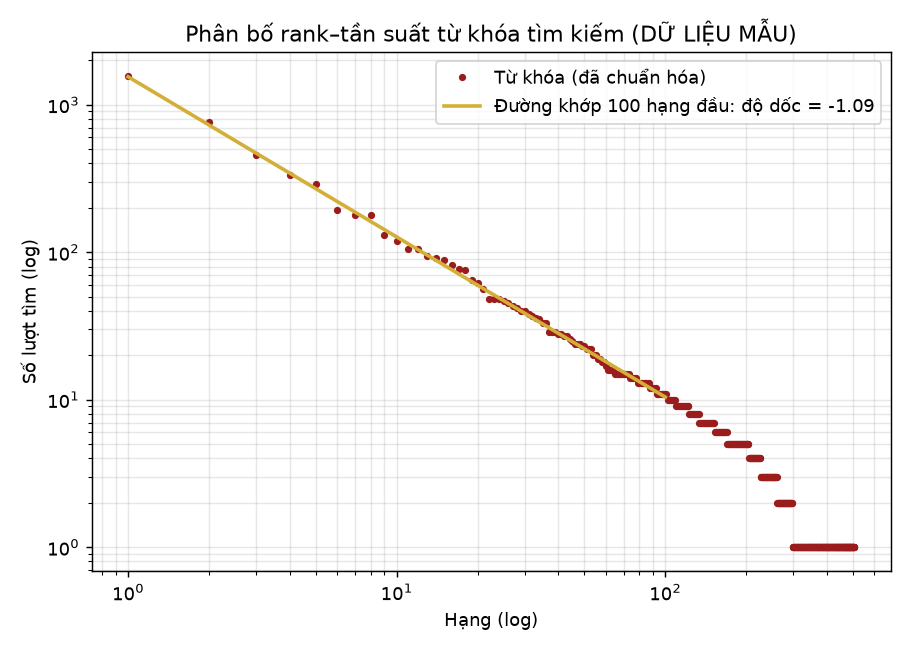

# Tóm tắt dữ liệu mô phỏng (seed 42)

Mọi dòng có `du_lieu_mau = true`.

| Bảng | Số dòng |
|---|---:|
| tai_lieu | 3400 |
| ma_van_de | 29 |
| ban_sao | 5817 |
| nguoi_dung | 63 |
| luot_muon | 400 |
| log_tim_kiem | 8000 |
| luot_doc | 1500 |

- Số tư liệu đã số hóa sẵn: **40**
- Tỉ lệ lượt tìm 0 kết quả: **11.8%**
- Tỉ lệ log có `tai_lieu_chon_id`: **41.8%**
- Độ dốc log-log 100 hạng đầu: **-1.09** (Zipf s≈1.1 → độ dốc ≈ -1.1; lệch do gộp biến thể không dấu và lỗi gõ)

## Lượt mượn theo trạng thái

| Trạng thái | Số |
|---|---:|
| cho_duyet | 15 |
| da_tra | 300 |
| dang_muon | 50 |
| tu_choi | 35 |

## Top 10 từ khóa

| # | Từ khóa | Lượt |
|---:|---|---:|
| 1 | lưu trữ | 1566 |
| 2 | tài liệu | 763 |
| 3 | công tác | 455 |
| 4 | học máy | 334 |
| 5 | việt nam | 290 |
| 6 | tổ chức | 194 |
| 7 | python | 179 |
| 8 | văn phòng | 179 |
| 9 | quản lý | 131 |
| 10 | khoa học | 120 |

